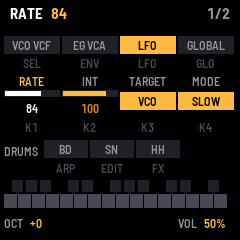

# FMtribe

FMtribe will recreate the sound and controls of a classic monophonic analogue groove box on the M-VAVE FM-1. This
early build still plays fm1-base's starting voice: the keys play a simple voice with velocity and pressure, a few
controls set the octave, the wave and the volume and save your settings, and MIDI goes out over USB and Bluetooth.
This manual describes that build and will be rewritten as the instrument arrives.

---

## Contents

1. Install
2. The screen
3. Controls
4. Saving
5. MIDI and audio
6. The screen mirror
7. The screen reader
8. Troubleshooting

---

## 1. Install

To try it first, open the emulator. It runs the same code in your browser, with sound, and you can play it with a
mouse, a touch screen or your computer keyboard.

To install it from the browser, use Chrome or Edge. Connect the FM-1 by USB, open the installer and press Install.
The browser asks once to allow MIDI, so allow it. Don't unplug the cable while it writes.

To install it from a terminal, run `python3 base/tools/fm1_install.py fmtribe-VERSION.fwsc` from FMtribe's source.

To go back to the stock firmware, use the installer's last section, which writes M-VAVE's own firmware back. You
can recover an FM-1 that doesn't start, too. For details, see felucca-bsp's `tools/fm1_rescue.sh`.

---

## 2. The screen

| Part | What it shows |
| --- | --- |
| Header | The name, and BLE, which lights while a computer or tablet is connected over Bluetooth. While you play a key, it shows the note, the velocity it landed at (V) and how hard you're pressing it (P). After a change, a message shows here for a moment. |
| Buttons | All 14, by their names. A button lights while you hold it. |
| Knobs | The seven encoders, each with a count of its turns. A knob lights for a moment as you turn it. |
| Keys | The 27 keys, black above white. A held key fills up to its velocity, and white over that shows its pressure. |
| Bottom line | The octave, the wave (on PRESET) and the volume (MASTER). |

---

## 3. Controls

| Control | What it does |
| --- | --- |
| Keys | Play the voice, louder the harder they land. Each key also sends its note with its velocity over USB and Bluetooth, on channel 1. Press a held key harder to send aftertouch. The last key you pressed is the one that sounds. |
| OCT− · OCT+ | Set the octave, from −2 to +2. |
| PRESET | Picks the wave: sine or triangle. |
| MASTER | Sets the volume. |
| SAVE | Saves the octave, the wave and whether Bluetooth is on or off. SAVE lights while there's something to save. |
| REC | Press it to find and connect a Bluetooth MIDI device. Hold it for a second to switch Bluetooth off or on. For details, see MIDI and audio. |
| Every other button and knob | Shows its name on the screen, and does nothing else yet. The synth, drums and sequencer will use them. |

---

## 4. Saving

Press SAVE to keep the octave, the wave and whether Bluetooth is on. They come back the next time the FM-1 starts. SAVE stays lit while
there are changes to save.

---

## 5. MIDI and audio

MIDI comes in over USB, Bluetooth and the TRS jack. A note on any channel plays the voice, and a note off releases
it. The keys send notes with their velocity, and poly aftertouch, out over USB and Bluetooth.

Over Bluetooth, FMtribe shows up as "FM-1". On a Mac, open Audio MIDI Setup, choose Window > Show MIDI Studio,
click the Bluetooth button, then click Connect next to FM-1. On an iPad or iPhone, connect from a music app's
Bluetooth MIDI settings.

To switch Bluetooth off, hold REC for a second. The screen says BLUETOOTH OFF, and the FM-1 stops advertising and
drops any connection. Hold REC again to switch it back on. To keep your choice for the next time the FM-1 starts,
press SAVE.

To connect FMtribe to a Bluetooth MIDI device, such as a keyboard or a controller, first put the device in its
pairing or advertising mode. Then press REC, and the screen says BLE SCANNING. Turn ALGORITHM to pick the device
by its name, and press REC again to connect. DEV in the header lights while it's connected, and the bottom line
shows the last message it sent. To disconnect, press REC once more.

The keys sense how hard you play them, with no change to the FM-1. The 20 lowest keys
(F3 to C5) give velocity and pressure. The top seven give velocity only.

Over the USB cable, the FM-1 is also a sound card. Your computer can record what it plays from an input named
"FMtribe FM-1". It can also play through the FM-1: choose "FMtribe FM-1" as the output, and you'll hear it from
the FM-1's speaker and headphones, mixed with the FM-1's own sound, at MASTER's volume.

---

## 6. The screen mirror

The site's [Mirror](../mirror/) page shows the FM-1's screen and panel live on your computer, in Chrome or Edge,
over the USB cable. Press Connect and allow MIDI. Press Control to play the FM-1 from the page: click its buttons
and keys, and scroll over a knob to turn it. Close other programs that use the FM-1's MIDI port first.

---

## 7. The screen reader

FMtribe tells a screen reader what's on its screen, through the
[FM-1 Screen Reader](https://charlesvestal.github.io/fm1-reader/). When the reader starts listening, it hears the
name and the settings, and then each change as it happens. The emulator does the same, with your own screen
reader or with its built-in voice.

---

## 8. Troubleshooting

If you hear no sound, turn MASTER up. The voice plays only while you hold a key.

If the installer doesn't find the FM-1, use Chrome or Edge, and allow MIDI when the browser asks. Close any other
programs that use the FM-1's MIDI port.

If the FM-1 doesn't start after an install, it starts in SAFE MODE after two failed starts. There's no sound, but
USB works, so the web installer can reach it. Install again, or put the stock firmware back from the same page.
Press PLAY to try starting the firmware again. If even safe mode fails twice, the FM-1 drops into the chip's own
update mode.

To put the FM-1 in update mode, hold REC while you switch it on. If you installed m-bootloader with the web
installer, the installer can reach the FM-1 from there, and holding PLAY instead opens m-bootloader's recovery
menu. Without m-bootloader, REC starts the chip's own update mode, which only the rescue can reach. For details,
see felucca-bsp's `tools/fm1_rescue.sh`.
