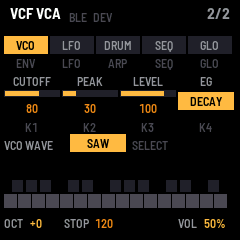
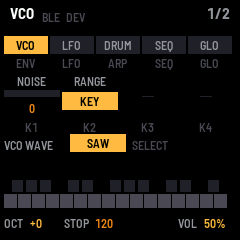
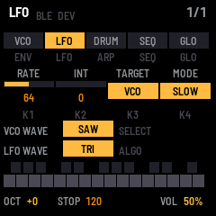
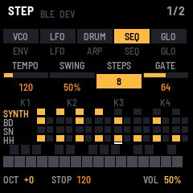
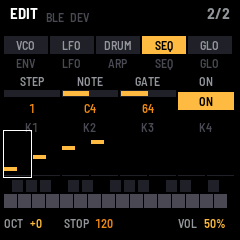
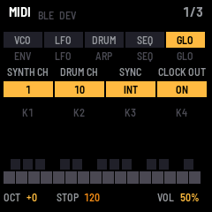

# FMtribe

FMtribe will recreate the sound and controls of a classic monophonic analogue groove box on the M-VAVE FM-1. This
build has the synth voice, the LFO, the drums and the step sequencer, with the monotribe's step row on the keys: one oscillator (saw, triangle or square) and
noise into a two-pole MS-style low-pass filter that self-oscillates, a VCA with three fixed envelopes, an LFO on
the pitch, the filter or both, a bass drum, snare and hi-hat, and an 8-step sequencer for all four parts. The
ribbon modes, Flux recording and drum rolls come next. The sound is fitted to recordings of real units, so treat
it as an estimate until it has been compared side by side with one.



---

## Contents

1. Install
2. The screen
3. Controls
4. Setting gate times
5. Saving
6. MIDI and audio
7. The screen mirror
8. The screen reader
9. Troubleshooting

---

## 1. Install

To try it first, open the emulator. It runs the same code in your browser, with sound, and you can play it with a
mouse, a touch screen or your computer keyboard.

To install it from the browser, use Chrome or Edge. Connect the FM-1 by USB, open the installer and press Install.
The browser asks once to allow MIDI, so allow it. Don't unplug the cable while it writes.

To install it from a terminal, run `python3 base/tools/fm1_install.py fmtribe-VERSION.fwsc` from FMtribe's source.

To go back to the stock firmware, use the installer's last section, which writes M-VAVE's own firmware back. You
can recover an FM-1 that doesn't start, too. For details, see felucca-bsp's `tools/fm1_rescue.sh`.

---

## 2. The screen


| Part | What it shows |
| --- | --- |
| Header | The page you're on, such as VCF VCA, and BLE and DEV, which light while a computer or a Bluetooth MIDI device is connected. At the right, which page of its button it is, such as 2/2, and while you play a key, the note. After a change, a message shows here for a moment, such as CUTOFF 100. |
| Tabs | The pages' buttons: VCO (ENV), LFO, DRUM (ARP), SEQ and GLO. The one you're on is lit, and so is its button. |
| K1 to K4 | What the four knobs do on this page. A knob shows a bar and its value; a switch shows its position. Each lights for a moment as you turn it. |
| Below the knobs | On the synth pages, the VCO's WAVE (SELECT) and, on LFO, the LFO's WAVE (ALGO). On DRUMS, the pads. On STEP, the pattern, a row a part. On EDIT, the synth's steps as a piano roll. |
| Keys | The 27 keys, black above white. A held key fills up. |
| Bottom line | The octave, PLAY or STOP and the tempo (/2 with HALF TEMPO, REC when armed, GATE with GATE TIME HOLD), the last MIDI message in, and the volume (MASTER). |

---

## 3. Controls

The pages follow the monotribe's panel from left to right: the VCO and VCF on ENV, then the LFO, then the drums and
the sequencer. A page's button shows it; press the button again for its next page. The four knobs K1 to K4 edit
the page on the screen. A switch moves one position for each click of the knob.

| Page (button) | K1 | K2 | K3 | K4 |
| --- | --- | --- | --- | --- |
| VCO 1/2 (ENV) | NOISE | RANGE | | |
| VCF VCA 2/2 (ENV) | CUTOFF | PEAK | LEVEL | EG |
| LFO (LFO) | RATE | INT | TARGET | MODE |
| DRUMS (ARP) | RHYTHM | BD DECAY | SN DECAY | HH DECAY |
| STEP 1/2 (SEQ) | TEMPO | SWING | STEPS | GATE |
| EDIT 2/2 (SEQ) | STEP | NOTE | GATE | ON |
| MIDI 1/3 (GLO) | SYNTH CH | DRUM CH | SYNC | CLOCK OUT |
| GLOBAL 2/3 (GLO) | BLE MIDI | KEY LIGHT | GLOW | |
| DEVICES 3/3 (GLO) | DEVICE | | | |

Three controls do the same job on every page:

| Control | What it does |
| --- | --- |
| OCT− · OCT+ | The octave, in six steps from −3 to +2, as the monotribe's six octave positions. |
| SELECT | The VCO's WAVE: saw, triangle or square. On the SEQ pages, it moves the step cursor instead. |
| ALGO | On the LFO page, the LFO's WAVE: saw, triangle, square or S&H. |

 

| Setting | What it does |
| --- | --- |
| NOISE | White noise beside the oscillator, into the filter. |
| RANGE | The ribbon's range: WIDE, NARROW or KEY. The keys play KEY (a semitone a key) for now; WIDE and NARROW are still to come. |
| WAVE (SELECT) | The oscillator: saw, triangle or square. |
| CUTOFF | The filter's cutoff, from about 80 Hz to about 18 kHz. |
| PEAK | The filter's resonance. Near the top, the filter whistles on its own at the cutoff while a note plays. |
| LEVEL | The synth's volume. |
| EG | The envelope. DECAY jumps to full when a note starts and dies away over about 1.3 seconds, even while you hold the key. GATE stays full while you hold it. ATTACK rises over about 1.3 seconds while you hold it. All three close quickly when you let go. |
| RATE | The LFO's speed: about 1 Hz to 5 kHz in FAST, 0.05 Hz to 18 Hz in SLOW and 1 SHOT. |
| INT | How much the LFO moves the pitch or the filter, from none at 0. At the top, the pitch swings an octave either way and the cutoff three octaves. |
| TARGET | What the LFO moves: VCO (the pitch), VCO+VCF (both) or VCF (the cutoff). |
| MODE | FAST and SLOW run all the time. FAST and 1 SHOT start again with each new note. 1 SHOT plays half a cycle when a note starts and then stops, like a second envelope. |
| WAVE (ALGO) | The LFO: saw (falling), triangle, square, or S&H, a new random level each cycle. |
| RHYTHM | The drums' volume. |
| BD DECAY · SN DECAY · HH DECAY | Each drum's decay, as the popular hardware decay mods give it. 32 is the stock decay; lower is shorter, higher is up to about 15 times as long. |
| SYNTH CH | The MIDI channel the synth plays on and the keys send on, 1 to 16 (1 at first). |
| DRUM CH | The MIDI channel the drums play on and send on, 1 to 16 (10 at first). |
| SYNC | INT runs at TEMPO; MIDI follows MIDI clock, start and stop from a computer or another instrument. |
| CLOCK OUT | Sends MIDI clock, start and stop, so other gear follows FMtribe. |
| BLE MIDI | Bluetooth MIDI on or off. |
| KEY LIGHT | The keys' lights: OFF; HELD, the keys you hold; or GUIDE, those and the keys that do something special on the page you're on, such as the drum pads and the step LEDs. |
| GLOW | How brightly the unlit buttons and the guide keys glow: OFF, LOW or HIGH. |
| DEVICE | On DEVICES, the Bluetooth MIDI device to connect to: see MIDI and audio. |

| Button | What it does |
| --- | --- |
| Keys | Play the synth. The last key you pressed sounds, and each new key starts the envelope again, as the monotribe's ribbon does. Let go of it while holding another, and the pitch goes back to the one still held. The volume doesn't follow how hard you play, as on the monotribe. Each key also sends its note on the synth's channel. On STEP, the keys are the sequencer's buttons instead. |
| MASTER | Sets the volume. |
| SAVE | Saves every setting, the octave and the pattern. SAVE lights while there's something to save. On the DEVICES page, SAVE connects to a Bluetooth MIDI device instead. |
| PLAY · REC | Start and stop the sequencer; record into it. See The sequencer. |
| SEL · EDIT · HOME · FX | Show their names, and do nothing else yet. |

### The drums

On the DRUMS page, the black keys in the two F♯–G♯–A♯ groups play the bass drum, snare and hi-hat, and glow to
show it (KEY LIGHT on GUIDE). The white keys still play the synth, so you can play both. The other black keys do
nothing there.

### The sequencer

FMtribe plays one pattern of 8 steps, a 16th note each, for four parts: SYNTH, BD, SN and HH, as the monotribe
does. Each step has a second slot half-way through it, for the drums' in-between hits and, with 16-STEP SYNTH, the
synth's in-between notes. Each part has its own active steps, so a part with fewer steps cycles against the others.

PLAY starts the pattern from step 1 and stops it. PLAY lights green while it plays, red while it records.

#### STEP: the monotribe's step row, on the keys



On STEP (SEQ, 1/2), the keys become the monotribe's row of buttons. The white keys are the step buttons, and their
lights are the step LEDs. The black keys are the buttons beside them.

| Key | Monotribe button | What it does |
| --- | --- | --- |
| White keys F3 to F4 (the first eight) | Steps 1–8 | Switch the part's step on or off. A synth step switched on takes the last note you played. |
| White keys G4 to G5 (the next eight) | Steps 9–16 | With 16-STEP SYNTH, the synth's steps 9 to 16. |
| F♯3 · G♯3 · A♯3 | BD · SN · HH | Pick the part, and play its drum. Hold one and press a step for a hit half-way through that step. |
| C♯4 | SYNTH | Pick the synth part. |
| D♯4 | ACTIVE STEP | Hold it and press steps to switch them on or off for playback. One step always stays on. |
| F♯4 | GATE TIME | Hold it and touch the white keys to set gate times; stopped, it's the multi-function key. See Setting gate times. |

With KEY LIGHT on GUIDE, the white keys show the part, as the monotribe's step LEDs do:

| Light | Meaning |
| --- | --- |
| Off | A step that doesn't play: switched off with ACTIVE STEP, or past step 8 (unless 16-STEP SYNTH is on). |
| Dim | An active step with nothing on it. |
| Half-lit | A step with a note or a hit. |
| Lit | The step playing now. Stopped, on the synth part, the step cursor. |

While you hold ACTIVE STEP, the active steps are lit instead. The part keys glow, with the part you're editing lit.
ACTIVE STEP and GATE TIME glow; GATE TIME stays lit while GATE TIME HOLD is on.

The knobs on STEP set TEMPO (10 to 600 BPM), SWING (every second step later, from straight, 50 %, to a triplet
feel, 67 %), STEPS (8 or 16, the same as 16-STEP SYNTH) and GATE, the gate time a new synth step gets.

#### The multi-function key

When the sequencer is stopped, hold GATE TIME (F♯4) and press a step key, as on the monotribe Ver.2:

| Step | Function |
| --- | --- |
| 1 | INITIALIZE ALL: clears the whole pattern. |
| 2 | INITIALIZE SYNTH: clears the synth part. |
| 3 | INITIALIZE RHYTHM: clears the drums. |
| 4 | INITIALIZE ACTIVE STEP: turns every part's steps back on. |
| 5 | SAMPLE & HOLD: the LFO's WAVE to S&H, or back. |
| 6 | 16-STEP SYNTH: on or off. |
| 7 | GATE TIME HOLD: on or off. See Setting gate times. |
| 8 | HALF TEMPO: the sequencer at half the tempo shown, on or off. |

#### EDIT: one step at a time



EDIT (SEQ, 2/2) sets the synth's steps exactly, which the monotribe can only do by playing them in. The screen shows
the synth's steps as a piano roll: each note at its pitch, as long as its gate. The box is the step cursor.

| Control | What it does |
| --- | --- |
| SELECT or K1 STEP | Moves the cursor a step at a time (a half-step with 16-STEP SYNTH). |
| Keys | Play a note to put it in the cursor's step and switch that step on. The cursor moves on to the next step, so you can type in a melody. |
| K2 NOTE | The step's note, a semitone a click. |
| K3 GATE | The step's gate time, from 1.4 % of the step to 100 %, then TIE. |
| K4 ON | Whether the step plays. |

#### Recording

To record, press REC (it lights), then PLAY. While REC is on, the keys play and record the synth on any page,
landing on the nearest step (or half-step with 16-STEP SYNTH), and how long you hold a note sets its gate time. On
the DRUMS page the pads record the drums. Recording adds to the pattern; to start again, use INITIALIZE. Press REC
again to stop recording.

The pattern is kept with the settings when you press SAVE.

---

## 4. Setting gate times

The gate time is how long each synth note sounds, as a share of its step. At 1.4 % a note is a short blip; at 100 %
it fills its step. TIE, set on EDIT, lets a note run on into the next one without a new attack.

```
   1.4 %          50 %                 100 %
  |▌      |      |████    |           |████████|
   step 1          step 2               step 3
```

There are three ways to set it.

**Play it live, the monotribe way.** On STEP, while the pattern plays, hold GATE TIME (F♯4) and touch the white
keys. They work as the monotribe's ribbon does with its GATE TIME button: the leftmost white key (F3) is the
shortest gate, 1.4 %, and the rightmost (G5) is 100 %, where each note runs into the next, with the keys between in even steps. Every synth note takes
that gate while you hold GATE TIME. Let go, and the notes go back to their own gates. Nothing is stored.

**Record it.** Press REC, then PLAY. Hold GATE TIME and touch a white key: each synth step takes that gate as it
plays, and keeps it. Touch other keys as the pattern goes round to give each step its own gate. Let go of GATE
TIME, and press REC again to stop recording.

**Hold it.** With the sequencer stopped, hold GATE TIME and press step 7 to turn GATE TIME HOLD on (GATE shows in the
bottom line, and the GATE TIME key stays lit). Then the gate you set with GATE TIME stays after you let go, until
you set another or turn GATE TIME HOLD off the same way.

**Set one step exactly.** On EDIT, move the cursor to the step with SELECT and turn K3 GATE. It goes from 1.4 % to
100 %, then TIE. New steps you switch on take the gate set by GATE on STEP.

---

## 5. Saving

Press SAVE to keep every setting, the octave and whether Bluetooth is on. They come back the
next time the FM-1 starts. SAVE stays lit while there are changes to save. Settings saved by an earlier FMtribe
don't carry over, since this version keeps more of them.



---

## 6. MIDI and audio

MIDI comes in over USB, Bluetooth and the TRS jack, on the monotribe's own map. The channels are set on the MIDI
page (GLO, 1/3); at first the synth is on 1 and the drums on 10.

| Message | What it does |
| --- | --- |
| Notes on the synth's channel | Play the synth. Velocity is ignored. |
| Pitch bend on the synth's channel | Bends the synth up to 2 semitones either way. |
| Notes 36, 40, 42 on the drums' channel | Play the bass drum, snare and hi-hat. |
| CC 1 · CC 16 | LFO INT · LFO RATE. |
| CC 80 | EG: about 32 DECAY, 64 GATE, 96 ATTACK. |
| CC 81 | LFO TARGET: 32 VCO, 64 VCO+VCF, 96 VCF. |
| CC 82 | LFO MODE: 32 FAST, 64 SLOW, 96 1 SHOT. |
| CC 83 | LFO WAVE: 32 saw, 64 triangle, 96 square, 127 S&H. |
| CC 7 | LEVEL. |
| Clock, start, stop | With SYNC on MIDI (MIDI, GLO 1/3), the sequencer follows them. |

The CCs are read on the synth's channel. The sequencer sends its notes out too, on the same channels, and MIDI
clock, start and stop with CLOCK OUT on. The keys send notes, with their velocity and poly aftertouch, out over USB
and Bluetooth on the synth's channel, and the drum pads send theirs on the drums' channel.

Over Bluetooth, FMtribe shows up as "FM-1". On a Mac, open Audio MIDI Setup, choose Window > Show MIDI Studio,
click the Bluetooth button, then click Connect next to FM-1. On an iPad or iPhone, connect from a music app's
Bluetooth MIDI settings.

To switch Bluetooth off, set BLE MIDI to OFF on GLOBAL 2/3 (GLO). The FM-1 stops advertising and drops any
connection. To keep your choice for the next time the FM-1 starts, press SAVE.

To connect FMtribe to a Bluetooth MIDI device, such as a keyboard or a controller, first put the device in its
pairing or advertising mode. Then open the DEVICES page (GLO, pressed until it shows 3/3): the FM-1 looks for
devices while the page is up. Turn K1 to pick the device by its name, and press SAVE to connect. DEV in the header
lights while it's connected, and the bottom line shows the last message it sent. To disconnect, press SAVE on that
page again.

The keys sense how hard you play them, with no change to the FM-1. The 20 lowest keys
(F3 to C5) give velocity and pressure. The top seven give velocity only.

Over the USB cable, the FM-1 is also a sound card. Your computer can record what it plays from an input named
"FMtribe FM-1". It can also play through the FM-1: choose "FMtribe FM-1" as the output, and you'll hear it from
the FM-1's speaker and headphones, mixed with the FM-1's own sound, at MASTER's volume.

---

## 7. The screen mirror

The site's [Mirror](../mirror/) page shows the FM-1's screen and panel live on your computer, in Chrome or Edge,
over the USB cable. Press Connect and allow MIDI. Press Control to play the FM-1 from the page: click its buttons
and keys, and scroll over a knob to turn it. Close other programs that use the FM-1's MIDI port first.

---

## 8. The screen reader

FMtribe tells a screen reader what's on its screen, through the
[FM-1 Screen Reader](https://charlesvestal.github.io/fm1-reader/). When the reader starts listening, it hears the
name and the settings, and then each change as it happens. The emulator does the same, with your own screen
reader or with its built-in voice.

---

## 9. Troubleshooting

If you hear no sound, turn MASTER and LEVEL up, and CUTOFF too: with CUTOFF low and PEAK low, the filter lets
little through. With the DECAY envelope, a note dies away after about a second even while you hold the key; on the
VCF VCA page (ENV, 2/2), set EG to GATE for a note that lasts. For the drums, turn RHYTHM up on the DRUMS page (ARP). If the
pitch wobbles, turn INT down on the LFO page.

If the installer doesn't find the FM-1, use Chrome or Edge, and allow MIDI when the browser asks. Close any other
programs that use the FM-1's MIDI port.

If the FM-1 doesn't start after an install, it starts in SAFE MODE after two failed starts. There's no sound, but
USB works, so the web installer can reach it. Install again, or put the stock firmware back from the same page.
Press PLAY to try starting the firmware again. If even safe mode fails twice, the FM-1 drops into the chip's own
update mode.

To put the FM-1 in update mode, hold REC while you switch it on. If you installed m-bootloader with the web
installer, the installer can reach the FM-1 from there, and holding PLAY instead opens m-bootloader's recovery
menu. Without m-bootloader, REC starts the chip's own update mode, which only the rescue can reach. For details,
see felucca-bsp's `tools/fm1_rescue.sh`.
